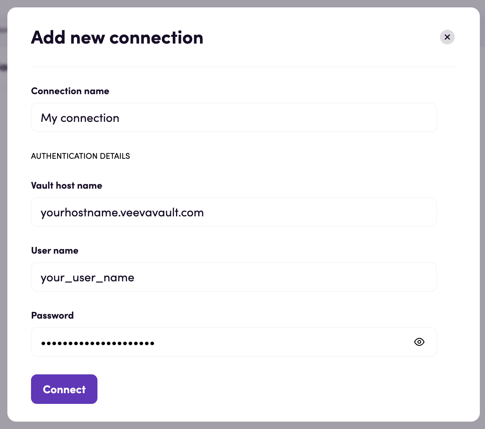

# Blackbird.io Veeva Vault

Blackbird is the new automation backbone for the language technology industry. Blackbird provides enterprise-scale automation and orchestration with a simple no-code/low-code platform. Blackbird enables ambitious organizations to identify, vet and automate as many processes as possible. Not just localization workflows, but any business and IT process. This repository represents an application that is deployable on Blackbird and usable inside the workflow editor.

## Introduction

<!-- begin docs -->

Veeva Vault is the proven cloud-based platform for the life sciences industry. 
Find and view documents, complete document tasks, see real-time dashboards.

## Before setting up

Before connecting, make sure you have an active Veeva Vault instance. 
Copy its host name from the browser search bar (example: https://yourinstance.veevavault.com/ - copy only `yourinstance.veevavault.com`)
as you will need it to create a new connection.

## Connecting

1. Navigate to apps and search for Veeva Vault.
2. Click _Add connection_ and name your connection for future reference e.g. 'My connection'.
3. Input your Vault host name, username and password.
4. Click _Connect_.

## Actions

### Bulk translations

- **Export bulk translations file** Export a CSV bulk translations file
- **Import bulk translations file** Import a bulk translations file

### Documents

- **Search documents** Search documents with a specific criteria
- **Get document** Get details for a specific document
- **Update document** Update fields of a specific document
- **Download document attachment** Download the latest version of the specified attachment from the document
- **Upload document attachment** Create and upload an attachment on the latest version of a document
- **Download document** Download a specific document file
- **Create document** Create a new document from a file
- **Create document relationship** Create a new relationship on a document
- **Start document action** Initiate a user action

### Vault objects

- **Search object records** Search object records with a specific criteria
- **Get object record** Get details for a specific object record
- **Create object record** Create a new object record
- **Update object record** Update an editable field value for a specific object record

### Workflow tasks

- **Search workflow tasks** Search workflow tasks with a specific criteria
- **Get workflow task** Get details for a specific workflow task
- **Accept workflow task** Accept an available workflow task
- **Complete workflow task** Complete an available workflow task

## Events

### Documents

- **On document created or updated** Triggered when a document is created or updated.

### Vault objects

- **On object record created or updated** Triggered when a vault object record is created or updated.

## Feedback

Do you want to use this app or do you have feedback on our implementation? Reach out to us using the [established channels](https://www.blackbird.io/) or create an issue.

<!-- end docs -->
